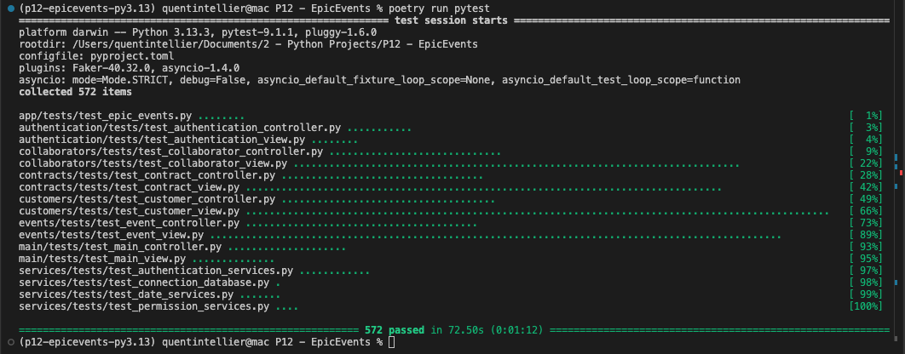
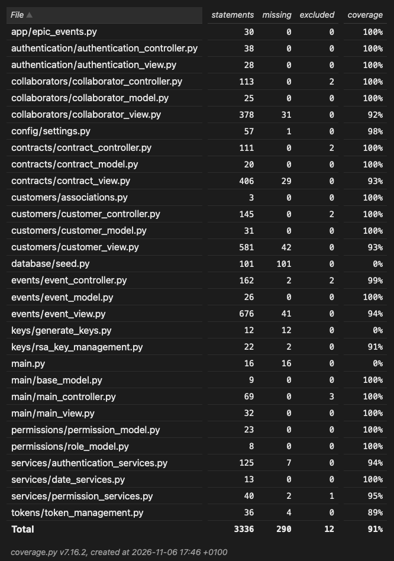

# EpicEvents CRM

## Event Management CRM - OpenClassrooms Project 12

EpicEvents CRM is a command-line interface (CLI) application developed in Python for comprehensive management of customers, contracts, and events. Built on the **Textual** library, it provides a rich and interactive interface directly in the terminal.

This project implements an MVC (Model-View-Controller) architecture with a secure authentication system using **JWT (JSON Web Tokens)** and **RSA keys**, along with a RBAC (Role-Based Access Control) permission system to control access to various features.

---

## Table of Contents

- [Overview](#overview)
- [Prerequisites](#prerequisites)
- [Installation and Configuration](#installation-and-configuration)
- [Database Initialization](#database-initialization)
- [Error Tracking with Sentry](#error-tracking-with-sentry)
- [Running the Application](#running-the-application)
- [Features](#features)
- [Technical Architecture](#technical-architecture)
- [Testing and Coverage](#testing-and-coverage)
- [Authentication System](#authentication-system)
- [RBAC Permission System](#rbac-permission-system)
- [Resources](#resources)
- [License](#license)
- [Authors](#authors)
- [Acknowledgments](#acknowledgments)

---

## Overview

EpicEvents CRM enables EpicEvents company collaborators to efficiently manage:

- **Customers**: Create, view, and update customer information and their contacts
- **Contracts**: Track contracts, their status (signed, pending, cancelled), and amounts
- **Events**: Plan and manage events with support representative assignment
- **Collaborators**: Manage the internal team (restricted to administrators)

The application is designed to meet the specific needs of three departments:
- **ADMIN**: Collaborator and contract management
- **SALES**: Customer and contract management
- **SUPPORT**: Event management

---

## Prerequisites

Before you begin, ensure you have the following installed on your system:

### Required Software
- **Python**: Version 3.13 or higher
- **MySQL**: Version 8.0 or higher
- **Git**: For version control
- **Poetry**: Python dependency manager

### Verify Prerequisites

```bash
# Check Python version
python --version
# or
python3 --version

# Check MySQL version
mysql --version

# Check Git is installed
git --version

# Check Poetry is installed
poetry --version
```

---

## Installation and Configuration

### 1. Clone the Repository

```bash
cd /path/to/your/projects
git clone https://github.com/Q1009/P12-EpicEvents.git
```

> **Note**: Replace the repository URL with your own fork if you have one.

### 2. Create and Activate Virtual Environment

#### With Poetry

```bash
# Navigate to the project directory
cd P12-EpicEvents

# Install dependencies with Poetry
poetry install

# Activate the virtual environment
poetry shell
```

### 3. Configure Environment Variables

Create an `.env` file and edit it with your MySQL connection information:

```env
# ===== Database =====
DB_HOST=localhost
DB_PORT=3306
DB_USER=epic_events_user
DB_PASSWORD=YourSecurePassword123!
DB_NAME=epicevents

# ===== Sentry =====
# SENTRY_DSN=https://xxx@sentry.io/xxx

# ===== Safety =====
# Generate a new secret key with: python -c "import secrets; print(secrets.token_hex(32))"
SECRET_KEY=your_64_character_hex_secret_key

# ===== Environment =====
ENVIRONMENT=development  # development|staging|production

# ===== JWT Configuration =====
JWT_ALGORITHM=RS256
JWT_ACCESS_TOKEN_EXPIRE_MINUTES=15
JWT_REFRESH_TOKEN_EXPIRE_DAYS=7
JWT_PRIVATE_KEY_PATH=keys/keys/jwt_private_key.pem
JWT_PUBLIC_KEY_PATH=keys/keys/jwt_public_key.pem

# ===== Passwords (for initial database seeding) =====
COLLAB_PASSWORD_1=password1
COLLAB_PASSWORD_2=password2
COLLAB_PASSWORD_3=password3
COLLAB_PASSWORD_4=password4
COLLAB_PASSWORD_5=password5
COLLAB_PASSWORD_6=password6
COLLAB_PASSWORD_7=password7
COLLAB_PASSWORD_8=password8
COLLAB_PASSWORD_9=password9
COLLAB_PASSWORD_10=password10
```

> **Important**:
> - Collaborator passwords are used for initial database seeding
> - Modify them before running the seed script
> - In production, use strong and unique passwords

---

## Database Initialization

### 1. Create MySQL Database

Connect to MySQL and create the database:

```bash
# Connect to MySQL (with root or admin user)
mysql -u root -p
```

```sql
-- Create the database
CREATE DATABASE IF NOT EXISTS epicevents CHARACTER SET utf8mb4 COLLATE utf8mb4_unicode_ci;

-- Create a dedicated user
CREATE USER IF NOT EXISTS 'epic_events_user'@'localhost' IDENTIFIED BY 'MyPassword123!';

-- Grant all privileges on the database to the user
GRANT ALL PRIVILEGES ON epicevents.* TO 'epic_events_user'@'localhost';

-- Apply changes
FLUSH PRIVILEGES;

-- Exit MySQL
EXIT;
```

### 2. Generate RSA Keys for JWT

RSA keys are required for signing and verifying JWT tokens. Run:

```bash
# From the project root
poetry run python -m keys.generate_keys
```

This will generate two files in `keys/keys/`:
- `jwt_private_key.pem`: Private key for signing tokens (MUST be protected)
- `jwt_public_key.pem`: Public key for verifying tokens

> **Important Security Notes**:
> - The private key must NEVER be shared or committed to version control
> - The `keys/keys/` directory is already in `.gitignore`
> - In production, consider encrypting the private key with a password

### 3. Apply Migrations

```bash
# Apply all migrations to create the database schema
poetry run alembic upgrade head
```

### 4. Seed the Database

The seed script creates:
- 3 departments (ADMIN, SALES, SUPPORT)
- 6 collaborators (3 Sales, 2 Support, 1 Admin)
- 10 customers with different types of contacts
- 10 locations
- 8 contracts (5 signed, 2 pending, 1 cancelled)
- 5 events
- Phone numbers associated with contacts

```bash
# Run the seeding script
poetry run python -m database.seed
```

> **Note**: The script completely resets the database (downgrade then upgrade) before seeding.

---

## Error Tracking with Sentry

EpicEvents CRM uses **Sentry** for real-time error tracking and monitoring, providing visibility into application errors, performance issues, and exceptions in production environments.

### Configuration

Sentry is configured via environment variables in your `.env` file:

```env
# ===== Sentry =====
SENTRY_DSN=https://your-public-key@sentry.io/your-project-id
```

### Setup Instructions

1. **Create a Sentry account** at [sentry.io](https://sentry.io) or log in to your existing account
2. **Create a new project** for EpicEvents CRM
3. **Copy the DSN** from your project settings
4. **Add the DSN** to your `.env` file:

```env
SENTRY_DSN=https://xxxxxxxxxxxxxxxxxxxxxxxxxxxxxxxx@o0.ingest.sentry.io/0
```

5. **Restart the application** for changes to take effect

### Use Cases

| Scenario | What Gets Logged | Benefits |
|----------|------------------|----------|
| **Creation & Update of a Collaborator** | Main data regarding the collaborator | Monitor collaborator management |
| **Contract Signature** | Main data regarding the contract | Keep track of contract history |
| **Any Unhandled Exception** | Unhandled exceptions, critical errors | Immediate alerts for production issues |

### Viewing Errors

Once configured, all errors will be visible in your Sentry dashboard.

---

## Running the Application

### Normal Launch

```bash
# From the project root
poetry run python main.py
```

---

## Features

### Authentication

| Feature | Description |
|---------|-------------|
| **Login** | Email/password authentication with JWT |
| **Logout** | Invalidate local tokens |
| **Auto-refresh** | Access tokens are automatically refreshed when expired |
| **Persistent Session** | Tokens are securely stored in `~/.epicevents/tokens.json` |

### Customer Management

| Feature | Description | Allowed Roles |
|---------|-------------|---------------|
| **List all customers** | Display all customers in the CRM | ADMIN, SALES, SUPPORT |
| **Create customer** | Add a new customer with contacts | ADMIN, SALES |
| **Update customer** | Update customer information | ADMIN, SALES (only their own customers) |
| **View customer** | View complete customer details | ADMIN, SALES, SUPPORT |

### Contract Management

| Feature | Description | Allowed Roles |
|---------|-------------|---------------|
| **List all contracts** | Display all contracts | ADMIN, SALES, SUPPORT |
| **Create contract** | Create a new contract for a customer | ADMIN, SALES |
| **Update contract** | Update contract information | ADMIN, SALES (only their own contracts) |
| **Change status** | Change contract status (pending -> signed -> cancelled) | ADMIN, SALES |

### Event Management

| Feature | Description | Allowed Roles |
|---------|-------------|---------------|
| **List all events** | Display all events | ADMIN, SALES, SUPPORT |
| **Create event** | Create an event linked to a contract | ADMIN, SALES |
| **Update event** | Update event information | ADMIN, SUPPORT (only their own events) |
| **Assign support** | Assign a support representative to an event | ADMIN |

### Collaborator Management

| Feature | Description | Allowed Roles |
|---------|-------------|---------------|
| **List all collaborators** | Display all collaborators | ADMIN |
| **Create collaborator** | Add a new collaborator | ADMIN |
| **Update collaborator** | Update collaborator information | ADMIN |
| **Delete collaborator** | Remove a collaborator | ADMIN |

### Interface and Navigation

The application uses **Textual** to provide a rich interface with:

- **Interactive menus** with cursor selection or keyboard shortcuts
- **Formatted display** with colors and custom styles
- **Notifications** for error and success messages
- **Real-time clock** in the header
- **Nord theme** for a pleasant visual experience

---

## Technical Architecture

### Technology Stack

| Component | Technology | Version |
|-----------|------------|---------|
| **Language** | Python | 3.13+ |
| **CLI Framework** | Textual | 8.2.8+ |
| **ORM** | SQLAlchemy | 2.0.51+ |
| **Database** | MySQL | 8.0+ |
| **Migrations** | Alembic | 1.18.5+ |
| **Authentication** | PyJWT + Cryptography | 2.8.0+ |
| **Hashing** | bcrypt | 5.0.0+ |
| **Environment Variables** | python-dotenv | 1.2.2+ |
| **Logging** | Sentry | 2.66.0+ |
| **Testing** | pytest | 9.1.1+ |
| **Formatting** | Ruff | ? |

---

## Testing and Coverage

### Tests Summary

To run the test suite:

```bash
# Run all tests
poetry run pytest -vv

# Run specific test file
poetry run pytest feature/tests/test_module.py -vv
```

#### 📊 Test Results

Here are the pytest testing results:



### Test Coverage Summary

To run the test suite and generate a coverage report:

```bash
# Run all tests with coverage and generate html report
poetry run coverage run -m pytest && poetry run coverage html 

# Open report
open htmlcov/index.html
```

The coverage report will be generated in the `htmlcov/` directory. Open `htmlcov/index.html` in your browser to view detailed coverage information.

#### 📊 Coverage Test Results

Here are the coverage results of the pytest tests in the current state of the project:




> **Note**: Coverage percentages are based on the latest test run.

## Authentication System

### How It Works

EpicEvents CRM uses a **JWT (JSON Web Tokens)** based authentication system with the **RS256** algorithm (RSA + SHA-256).

#### Authentication Flow:

```
Flow of the authentication system
```

### System Components

| Component | File | Role |
|-----------|------|------|
| **AuthController** | `authentication/authentication_controller.py` | Manages login/logout flow |
| **AuthView** | `authentication/authentication_view.py` | Credential input interface |
| **AuthService** | `services/authentication_services.py` | Authentication business logic |
| **TokenService** | `services/authentication_services.py` | Token generation and verification |
| **TokenManagement** | `tokens/token_management.py` | Secure token storage and access|
| **RSA Key Management** | `keys/rsa_key_management.py` | RSA key storage and access |

### Token Payload Structure

```json
{
  "sub": "1",           // User ID
  "jti": "uuid",        // Unique token identifier
  "type": "access",     // Token type (access or refresh)
  "exp": 1234567890,    // Expiration timestamp
  "iat": 1234567800     // Issued at timestamp
}
```

---

## RBAC Permission System

### RBAC Model (Role-Based Access Control)

EpicEvents CRM implements a Role-Based Access Control (RBAC) system with three main roles:

| Role | Primary Responsibilities | Access Scope | Key Permissions |
|------|--------------------------|--------------|-----------------|
| **ADMIN** | Team and contract management | Collaborators & Contracts | Create/read/update/delete collaborators, all contract management, assign support to events |
| **SALES** | Customer and contract lifecycle | Customers & Contracts | Create/read/update customers, create/update contracts, view events (read-only) |
| **SUPPORT** | Event planning and execution | Events | Create/read/update events, view customers/contracts (read-only), update their own assigned events |

### Key Permission Files

| File | Description |
|------|-------------|
| `permissions/permission_model.py` | Definition of all available permissions |
| `permissions/role_model.py` | Role to permissions mapping |
| `services/permission_services.py` | Permission verification services |

---

## Resources

- [Textual Documentation](https://textual.textualize.io/)
- [SQLAlchemy Documentation](https://www.sqlalchemy.org/)
- [Alembic Documentation](https://alembic.sqlalchemy.org/)
- [PyJWT Documentation](https://pyjwt.readthedocs.io/)
- [bcrypt Documentation](https://bcrypt.readthedocs.io/)
- [Cryptography Library](https://cryptography.io/)

---

## License

This project is licensed under a **custom Educational License** specifically designed for OpenClassrooms portfolio projects.

This project is developed as part of **Project 12** of the **Python Application Developer** path at OpenClassrooms. It is intended for **educational, portfolio, and professional demonstration purposes only**.

For full license details, see the [LICENSE](LICENSE) file.

### Quick Summary

**You are free to:**
- Use this code for personal learning and study
- Reference it in your portfolio or resume
- Demonstrate the application during job interviews
- Study, modify, and understand the codebase for educational purposes

**You may NOT:**
- Sell this code or use it in commercial products without explicit permission
- Remove or alter copyright notices
- Claim authorship or ownership of this software
- Distribute modified versions without maintaining the original license

**Copyright (c) 2026 Quentin Tellier** - All rights reserved.

---

## Authors

- **Quentin Tellier** - Developer
  - Email: quentin.tellier@outlook.com

---

## Acknowledgments

- Textual
- The Python community for the many open source libraries used
- Future contributors who will improve this project

---
